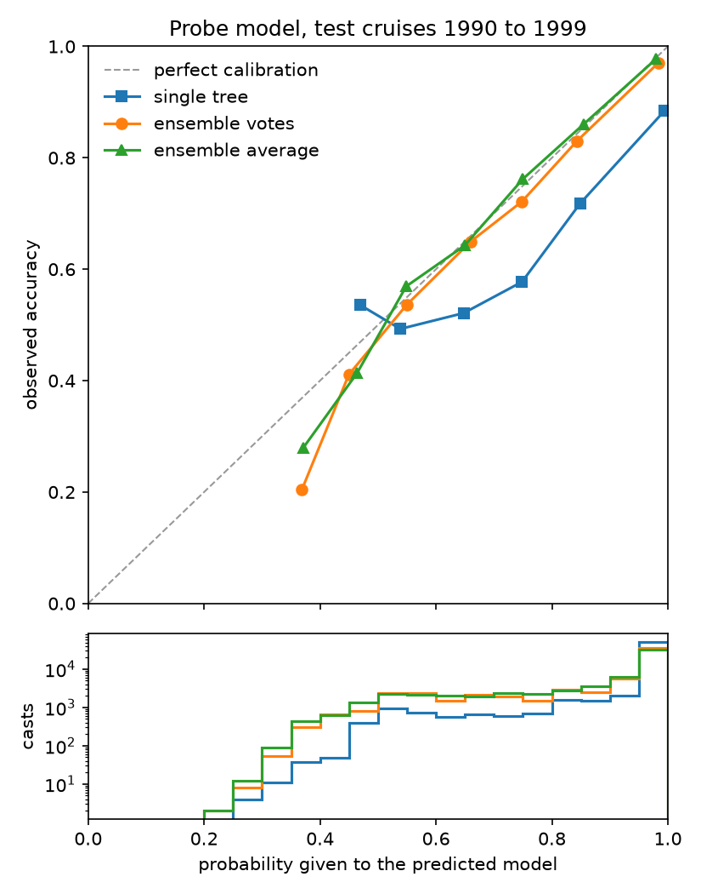
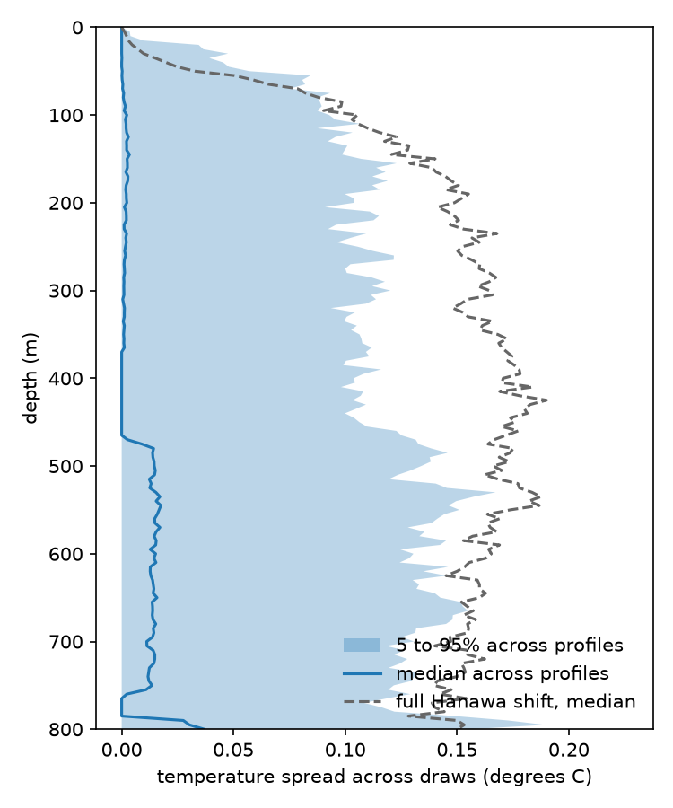

# XBT-Uncertainty

[](https://github.com/ShubhamX57/xbt-uncertainty/actions/workflows/tests.yml)

A small study of how well the probe type of historical ocean temperature
profiles can be inferred from their metadata, and how far the resulting
probabilities can be trusted.

This is a reproduction and learning project. It follows the approach of
Haddad et al. (2022), who used decision trees and ensembles of decision trees
to infer missing XBT probe types. It uses one decade of public data, a
simpler feature set and its own train and test split, so its numbers are not
comparable with theirs and are not claimed to match them. Nothing here is
presented as new science.

## Background

An expendable bathythermograph (XBT) is a probe dropped from a moving ship.
It measures temperature as it sinks, but it has no pressure sensor, so its
depth is calculated from the time since it entered the water with a fall-rate
equation, z = a t - b t^2. The coefficients depend on the probe model, and the
equation supplied by the manufacturer for the common T-4, T-6 and T-7 probes
was later found to place readings about 3% too shallow (Hanawa et al., 1994).

Correcting a profile therefore needs its probe type. About half of the XBT
casts in the World Ocean Database for 1990 to 1999 do not record it. Haddad et
al. (2022) trained models to fill in the missing types. This project asks a
narrower question: when such a model gives a probability for each type, are
those probabilities calibrated, and how much does the remaining uncertainty
change a corrected profile?

## Data

World Ocean Database yearly XBT files for 1990 to 1999 from NOAA NCEI, 6.24 GB
in total. The source, download method, checksums, variables used and known
issues are in [docs/data.md](docs/data.md).

| | casts |
| --- | ---: |
| all casts | 662,844 |
| with a named probe type | 318,695 |
| usable for training and testing (named type, ship-launched, on a known cruise) | 304,627 |

## Method and results

All results below come from the scripts in `scripts/` and are saved in
`results/`.

### Classifier (Stage 3)

The target is the probe model (T4, T7, Deep Blue and so on), not the full
label, because the label vocabulary changes in 1996 in a way that a model
could learn instead of the probe. Models seen on fewer than 50 cruises are
merged into OTHER, which leaves ten classes. Features are year, month,
latitude, longitude, deepest level and country.

Casts from one cruise nearly always share a probe model (93.0% of casts match
their cruise's most common model), so train and test are split by cruise:
20% of cruises are held out, and no cruise appears on both sides. Tree depth
is chosen by grouped cross-validation on the training cruises only.

| | macro F1 | accuracy |
| --- | ---: | ---: |
| most common model per year (baseline) | 0.160 | 0.528 |
| decision tree, test cruises | 0.645 | 0.849 |
| same tree, random split of casts | 0.830 | |

The random split overstates macro F1 by 0.185, which is the leakage the
cruise split avoids. The common models reach F1 of 0.86 to 0.90. T7 and Deep
Blue are often confused with each other because their depth ranges overlap,
and the rare classes are weak (T11 F1 0.19, XBT-7 0.34, OTHER 0.35). Per-class
results and the confusion matrix are in `results/stage3_metrics.json` and
`results/stage3_confusion.csv`.

### Calibration (Stage 4)

An ensemble of 50 trees is trained on bootstrap samples of training cruises.
Its probabilities are taken in two ways: the fraction of trees voting for each
class, and the mean of the trees' leaf probabilities. Both are scored on the
same test cruises as Stage 3, against a single tree and against the class
frequencies of each training year. Intervals are 2.5 to 97.5 percentiles over
200 resamples of test cruises.

| | accuracy | Brier score | log loss | ECE |
| --- | ---: | ---: | ---: | ---: |
| year frequency | 0.528 | 0.642 [0.599, 0.685] | 1.325 | 0.052 |
| single tree | 0.849 | 0.266 [0.221, 0.306] | 0.791 | 0.110 |
| ensemble, votes | 0.872 | 0.182 [0.150, 0.211] | 0.370 | 0.015 |
| ensemble, mean leaf probability | 0.872 | 0.180 [0.148, 0.208] | 0.358 | 0.007 |



The single tree is overconfident: it gives probability 1 to its top class for
62% of test casts. Both ensemble versions are close to calibrated for the top
class, and the two are indistinguishable on this data. The check covers the
probability of the predicted class only, and most test casts (64% with mean
leaf probabilities, 69% with votes) sit in the 0.9 to 1.0 bin.

### Corrected profiles (Stage 5)

WOD flags casts whose depths still need the Hanawa et al. (1994) correction.
On labelled casts it flags T4, T6, T7, Deep Blue and the Sparton XBT-4, XBT-6
and XBT-7, and never flags T10, T11, Fast Deep or the other Sparton models.
The ensemble's classes are grouped the same way, with OTHER treated as
uncorrected, so what decides the correction is the probability that a cast
belongs to the Hanawa group. On the
test cruises that probability is well calibrated (Brier score 0.032 on a 0 to
2 scale, ECE 0.005).

For unlabelled casts from 1990 to 1995 that WOD flags as needing the Hanawa
correction (186,307 casts with at least 10 levels), 200 probe types are drawn
from the ensemble probabilities for each of 500 randomly chosen casts. Each
draw is depth-corrected or not according to its group, and the spread in
temperature at fixed depths is measured. Five casts had too few accepted
levels, leaving 495.

| depth (m) | median spread (C) | 95th percentile (C) | median full Hanawa shift (C) |
| ---: | ---: | ---: | ---: |
| 100 | 0.002 | 0.093 | 0.103 |
| 200 | 0.002 | 0.104 | 0.145 |
| 300 | 0.001 | 0.120 | 0.163 |
| 500 | 0.015 | 0.134 | 0.166 |
| 700 | 0.011 | 0.131 | 0.147 |



For most casts the spread is negligible, because the classifier's main
confusion, T7 against Deep Blue, does not change the correction. For about one
cast in twenty the spread is as large as the correction itself. Where
temperature falls with depth, the correction moves readings deeper and so
warms the profile at a fixed depth.

## Limitations

- One decade (1990 to 1999) of one database release, downloaded on
  10 November 2026. NCEI updates WOD quarterly.
- Classifier and calibration are measured on labelled casts only. The
  unlabelled casts are shallower, more often lack a cruise id and are
  concentrated in the early 1990s, so their probabilities are not shown to be
  calibrated.
- All results come from one train and test split. Cross-validated macro F1
  varies by about 0.02 to 0.03 between folds.
- The classifier predicts probe model, not manufacturer. WOD's Kizu et al.
  (2005) correction depends on the manufacturer of T-5 probes and is not
  modelled.
- Stage 5 covers only uncertainty in probe type. It does not include the
  uncertainty in the Hanawa coefficients, and it assumes that the stored
  depths of models WOD does not correct are right. OTHER is treated as
  uncorrected, although 112 of its 776 usable casts are XBT-4 or XBT-6, which
  WOD does correct.
- Casts from 1996 onward are left out of Stage 5, because WOD records that the
  depth equation used for most of them is unknown.
- I could not access the full text of Haddad et al. (2022), so I cannot say
  whether they also measured calibration. Stage 4 is a calibration check of
  their approach, not a claim that it is the first.

## Reproducing

Python 3.12. The data download takes about 40 minutes.

```
python3.12 -m venv .venv
source .venv/bin/activate
python -m pip install -r requirements.txt
python -m pip install -e . --no-deps
sh scripts/download_wod.sh 1990 1999
python scripts/build_cast_table.py
python scripts/train_tree.py
python scripts/evaluate_uncertainty.py
python scripts/correct_unknown_profiles.py
python -m pytest
```

`download_wod.sh` compares the downloaded files with `data/checksums.txt`. A
mismatch most likely means NCEI has updated the files since, and counts will
differ.

Most tests run on small files written by `tests/conftest.py` in the WOD
layout. Three tests check the real 1999 file and are skipped when it is not
present.

## Layout

```
src/xbt_uncertainty/   reading WOD files, labels, features, ensemble, calibration, fall rates
scripts/               one script per stage
tests/                 pytest suite
results/               metrics and figures
docs/data.md           data provenance
```

## References

Haddad, S., Killick, R. E., Palmer, M. D., Webb, M. J., Prudden, R.,
Capponi, F. and Adams, S. V. (2022). Improved infilling of missing metadata
from expendable bathythermographs (XBTs) using multiple machine learning
methods. Journal of Atmospheric and Oceanic Technology, 39(9), 1367 to 1385.
https://doi.org/10.1175/JTECH-D-21-0117.1

Hanawa, K., Rual, P., Bailey, R., Sy, A. and Szabados, M. (1994). Calculation
of new depth equations for expendable bathythermographs using a
temperature-error-free method (application to Sippican/TSK T-7, T-6 and T-4
XBTs). UNESCO Technical Papers in Marine Science 67 (IOC Technical Series
42).

Kizu, S., Yoritaka, H. and Hanawa, K. (2005). A new fall-rate equation for T-5
expendable bathythermograph (XBT) by TSK. Journal of Oceanography, 61,
115 to 121.

World Ocean Database, NOAA National Centers for Environmental Information.
Yearly XBT files for 1990 to 1999, accessed 10 November 2026; see
docs/data.md.

## Licence

Code is released under the MIT licence, see [LICENSE](LICENSE). The WOD data
are not included and remain under NOAA's terms, described in
[docs/data.md](docs/data.md).
